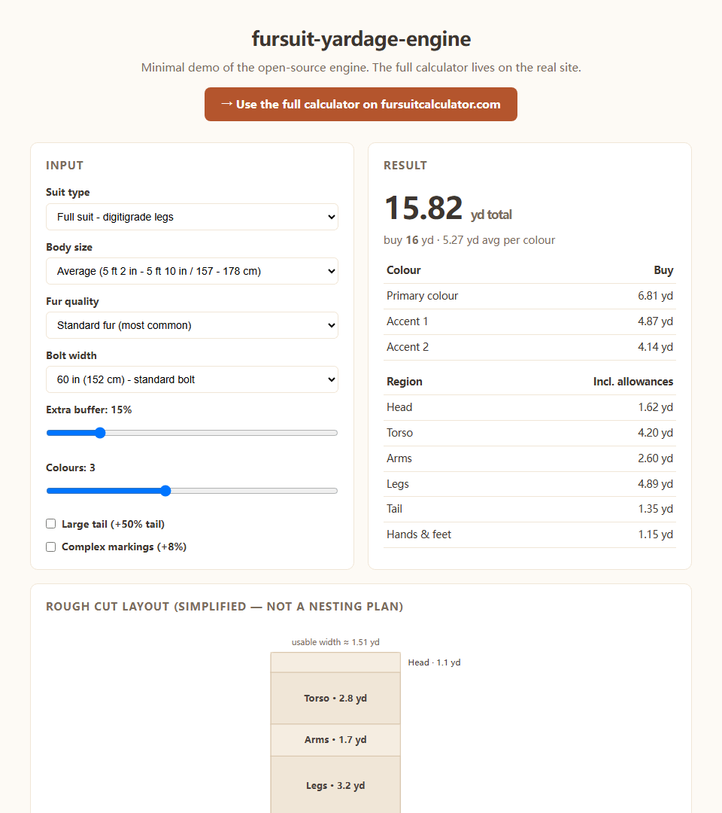

<div align="center">

# fursuit-yardage-engine

**The transparent calculation engine behind [fursuitcalculator.com](https://fursuitcalculator.com).**

[**→ Try the live calculator at fursuitcalculator.com ←**](https://fursuitcalculator.com)



[](https://www.npmjs.com/package/fursuit-yardage-engine)
[](LICENSE)
[](package.json)

</div>

Pure TypeScript functions that estimate how much faux fur a fursuit build needs.
No React, no DOM, no dependencies — just the math, the constants, and every
assumption documented so you can argue with it.

**As of publishing, no other npm package covers fursuit fur yardage.** This one
powers a real site that real makers use before ordering fabric.

## Why open source

Fabric is expensive and first-time makers routinely under-order. Most yardage
advice online is a forum post saying "I bought 12 yards and it was enough".
That is not a model.

This engine **is** a model, and it refuses to be a black box:

- Every constant is a **documented assumption**, not a hidden guess — see
  [`docs/calculation-model.md`](docs/calculation-model.md) for the full derivation.
- Every result carries its allowances broken out (waste, nap, buffer), so you
  can see exactly why the number is what it is.
- The whole input space (53,760 combinations) is swept by ~2.1 million property
  assertions on every test run.

Disagree with a constant? Open an issue with real consumption data from a
finished suit — that data should win.

## Install

```bash
npm install fursuit-yardage-engine
```

## Quick start

```ts
import { calculateYardage, formatResultAsText } from 'fursuit-yardage-engine';

const result = calculateYardage({
  suitType: 'full-digitigrade',
  bodySize: 'average',
  furQuality: 'standard',
  furWidthId: 'w60',
  bufferPercent: 15,
  colorCount: 3,
  largeTail: false,
  complexMarkings: false,
});

console.log(result.totalYards);  // 14.12
console.log(result.yardsToBuy);  // 15  (rounded up, ≥ 1 yard per colour)
console.log(result.yardsPerColor); // per-colour split, weighted by panel size

// Or print a plain-text estimate to paste into a supplier email:
console.log(formatResultAsText(input, result));
```

### Cut layout geometry

```ts
import { computeCutLayout } from 'fursuit-yardage-engine';

const layout = computeCutLayout(input, result);
// layout.pieces → [{ id: 'head', label: 'Head', yards: 1.1 }, ...]
// layout.allowanceYards → the allowance band that closes the gap to totalYards
```

This is **not** a nesting solver — each body region is one rectangle whose
length along the bolt is `area / usableWidth`. Renderers should label it as a
proportion check, exactly like [the live site does](https://fursuitcalculator.com).

### Share URLs

```ts
import { inputToQuery, applyQueryToInput } from 'fursuit-yardage-engine';

inputToQuery(input);
// 't=full-digitigrade&b=average&q=standard&w=w60&p=15&c=3'

applyQueryToInput(new URLSearchParams(location.search), DEFAULT_INPUT);
// every value validated against the real option lists; garbage falls back
```

Environment-agnostic (`URLSearchParams` only). The `./browser` subpath adds
window helpers (`hasCalculatorQuery`, `shareUrlFor`, `syncUrlToInput`) that
no-op safely under SSR.

## How the math works

Full derivation in [`docs/calculation-model.md`](docs/calculation-model.md).
The short version:

```
1. Reference areas     head 1.62 · torso 4.20 · arms 2.60 · legs 3.70 · tail 1.35 · hands/feet 1.15  (yd²)
                       × body size (0.85–1.22) × coverage × digitigrade legs ×1.32, large tail ×1.5

2. Area → linear yards usableWidthYd = ((boltWidthIn − 2) / 36) × (1 / napFactor)
                       baseYards = totalArea / usableWidthYd

3. Allowances          waste (8–14% by fur quality) + nap (4–14%) + buffer (0–100%, default 15%)
                       + complex markings ×1.08 + colour overhead ×(1 + (n−1)·0.06)

4. Colour split        weighted, not even: primary gets weight 1.4, accents taper 1.0 → 0.4
                       (an even split systematically under-orders the primary colour)

5. Purchase quantity   yardsToBuy = max(ceil(totalYards), colorCount)
```

Every one of these numbers is an assumption, documented and open to challenge.
The engine would rather show its work than be trusted blindly.

## API

| Export | What it does |
|---|---|
| `calculateYardage(input)` | Main entry. Returns total/base yardage, per-colour split, per-region breakdown, itemised allowances, warnings. Clamps and sanitises every input — never throws. |
| `formatResultAsText(input, result)` | Plain-text estimate for emails/forum posts. |
| `computeCutLayout(input, result)` | Pure geometry for a simplified cut-layout diagram. |
| `inputToQuery` / `applyQueryToInput` | URL query codec with full validation. |
| `usableWidthYd(widthIn, napFactor)` | The single width formula, exported so UI and engine can't drift. |
| `SUIT_TYPES` `BODY_SIZES` `FUR_QUALITIES` `FUR_WIDTHS` `PARTS` `DEFAULT_INPUT` | All constants, fully exported and mutable-friendly for custom UIs. |
| `fursuit-yardage-engine/browser` | Window helpers for the share-link flow. |

Types are included (`CalculatorInput`, `CalculationResult`, `PartResult`,
`ColorResult`, `CutLayout`, …). ESM only.

## Testing

```bash
npm test   # builds, then sweeps all 53,760 input combinations
```

The property suite asserts finiteness, non-negativity, total ≥ base, colour and
part sums reconstructing the total, buffer monotonicity, `yardsToBuy` rounding
rules, and that no formatted output ever contains `NaN` — for **every**
combination. On top of that, targeted semantic checks verify ordering
(head < partial < plantigrade < digitigrade), wider-bolt savings, and that
complex markings add exactly 8% of the subtotal.

The same suite runs as a parity check against the production engine on
fursuitcalculator.com before every release: 0 mismatches or it doesn't ship.

## Accuracy and honest limitations

These numbers are **documented assumptions, not measurements**. In real builds
expect ±20% depending on your pattern efficiency, pile direction and cutting
style. Known limitations, stated openly:

- One body-size scalar scales all regions together (a tall maker needs more
  torso, barely more head).
- Nap loss is modelled as a uniform width reduction, not pattern-piece packing.
- Lining, foam, stuffing, minky/fleece and dye lots are out of scope.

If you have real consumption data from a finished suit, [open an issue](https://github.com/cxl769807768/fursuit-yardage-engine/issues) — the
constants should improve with data.

## Used by

- [fursuitcalculator.com](https://fursuitcalculator.com) — the live calculator,
  plus field-tested guides like
  [how to calculate fur yardage](https://fursuitcalculator.com/guides/how-to-calculate-fur-yardage/)
  and [the fur waste allowance](https://fursuitcalculator.com/guides/fur-waste-allowance/).

Using it in your project? Send a PR to add yourself.

## License

[MIT](LICENSE) © Shawn Chen
